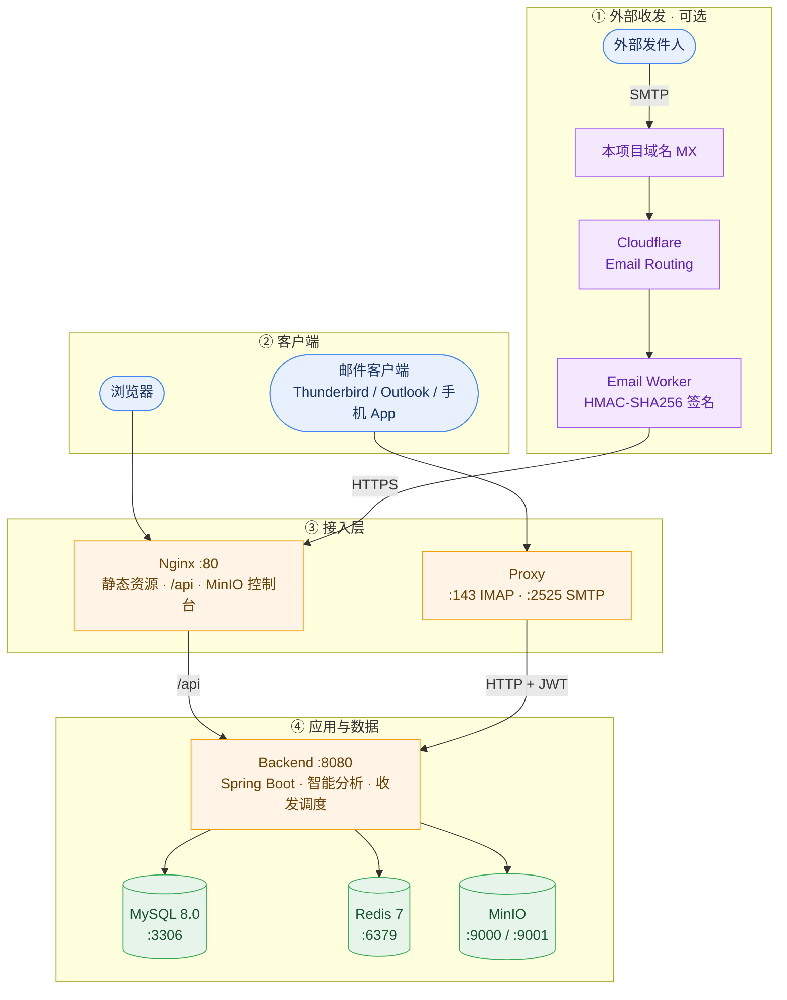

# 📮 智邮 CloudMail

> **基于 Spring Boot + Vue 3 + LLM 的全栈智能邮件系统**
> 站内邮件 · 外部收发 · SMTP/IMAP 客户端接入 · 智能分析与分类 · 管理后台

「智邮 CloudMail」不是又一个 Web 版收发信界面，而是一套**自托管**的邮件系统：
用两种途径把外部真实邮箱接进来，用 LLM 对每封来信做摘要、分类与风险识别，
同时通过标准协议把同一批邮件暴露给 Thunderbird / Outlook / 手机邮件 App。

---

## ✨ 核心能力

### 邮件功能
- 收发信、抄送、附件上传/预览/下载
- 收件箱 / 已发送 / 草稿箱 / 垃圾箱（软删除、批量操作、恢复、清空）
- 回复、转发（自动引用原文并复制附件）、全文搜索
- 已读状态、分页、未读数，Redis 缓存加速
- WebSocket + STOMP 实时新邮件推送（失败自动降级为轮询）

### 智能分析（可插拔插件架构）
统一 `PluginInterface`，前端可一键启用/禁用，LLM 不可用时自动回落到规则引擎：

| 插件 | 作用 |
|---|---|
| 垃圾邮件识别 | 关键词 + 规则引擎打分 |
| 邮件优先级排序 | 多维度内容评分 |
| 恶意链接 / 伪造发件人检测 | URL 分析与发件人校验 |
| 智能摘要 | 规则提取 + LLM 增强，异步处理不阻塞收信 |
| 智能分类 | 自动归入工作 / 个人 / 财务等 8 类 |

LLM 走 OpenAI 兼容的 Chat Completions 协议，也支持 Claude Messages 协议
（如 `https://api.deepseek.com/anthropic`），服务商可换、密钥按用户加密落库。

### 多协议接入
| 协议 | 用途 |
|---|---|
| HTTP REST | Web 端标准接口，见 [doc/API.md](doc/API.md) |
| WebSocket + STOMP | 实时推送 |
| SMTP / IMAP | 传统邮件客户端直连本系统账号，见 [proxy/README.md](proxy/README.md) |

### 外部收发：两条获得邮箱的途径
「邮箱账户」页提供两种方式，区别只在于邮箱归谁：

| | 绑定外部邮箱 | 领取本域地址 |
|---|---|---|
| 你要填 | 邮箱地址 + **授权码** | 只填一个用户名 |
| 收信 | 系统用 IMAP 登录你的邮箱拉取 | Cloudflare 收到后推送进来 |
| 发信 | 用你邮箱的 SMTP 服务器 | 系统级发信中继（Resend / SMTP） |
| 需要什么前置 | 无 | 管理员先配好 Cloudflare 与中继 |

两条路可同时存在，系统会自动判断当前部署能用哪条。完整说明、服务商速查表与
排障见 **[doc/MailAccounts.md](doc/MailAccounts.md)**。

### 管理后台
用户管理（角色 / 启停 / 重置密码）、反馈统计（分析准确率、LLM 与规则采纳率对比）、
邮箱账户监控（同步状态与失败原因）、系统配置（LLM 密钥掩码回显、插件开关、Prompt 模板版本）。

权限由后端 `AdminInterceptor` 对 `/admin/**`、`/plugin/**` 强制校验，前端路由守卫仅作体验优化。
保护措施：不能给自己降级、不能移除最后一个管理员、重置密码后强制改密并即时吊销已签发 Token。

---

## 🏗 系统架构



**“①外部收发”是可选链路**：不做任何配置时，系统就是一个完整的站内邮件系统；
配了 Cloudflare 才能收外部来信，配了发信中继才能往外部发信。

| 服务 | 端口 | 用途 |
|---|---|---|
| Nginx | 80 | 反向代理、静态资源、API 转发 |
| Frontend | — | Vue3 构建产物（写入共享卷，由 Nginx 提供） |
| Backend | 8080 | Spring Boot 核心服务 |
| MySQL 8.0 | 3306 | 关系型数据库 |
| Redis 7 | 6379 | 缓存、验证码、JWT 黑名单 |
| MinIO | 9000 / 9001 | 对象存储 API + 控制台 |
| MinIO-Init | — | 一次性建桶与策略 |
| Proxy | 143 / 2525 | SMTP/IMAP 协议代理 |

---

## 🚀 快速开始

**唯一前置条件：Docker + Docker Compose**，无需本地 JDK / Node.js / Maven / MySQL / Redis / MinIO。

```bash
cp .env.example .env        # 1. 复制模板，至少替换密码与 AES_SECRET_KEY
docker compose up -d        # 2. 构建并启动全部服务
docker compose ps           # 3. 查看状态
```

- **`AES_SECRET_KEY` 必填**，否则后端拒绝启动。用于加密落库的邮箱授权码与 LLM API Key，
  用 `openssl rand -base64 32` 生成。**该值变更后已加密的凭据无法解密**，需重新录入。
- **管理员账号**按 `.env` 中的 `ADMIN_INIT_EMAIL` / `ADMIN_INIT_PASSWORD` 首次启动时幂等创建，
  并强制首次登录改密。
- 修改前端后需重新构建：`docker compose up -d --build frontend`。
- 完全重置：`docker compose down -v`（删除数据卷）。

### 访问地址

| 服务 | 地址 | 说明 |
|---|---|---|
| 前端页面 | `http://localhost` | Nginx → 前端静态资源 |
| 后端 API | `http://localhost/api/` | Nginx → Backend (8080) |
| MinIO 控制台 | `http://localhost:9001` | 对象存储管理界面 |
| IMAP | `localhost:143` | 协议代理，客户端加密方式需选「无」 |
| SMTP | `localhost:2525` | 协议代理，认证选 `PLAIN` / `LOGIN` |

---

## 📁 项目结构

```
email-system/
├── backend/          Spring Boot 后端（controller / service / mapper / plugin / websocket）
├── frontend/         Vue3 前端（views / composables / stores / api），含 admin 管理端
├── deploy/
│   ├── nginx/        反向代理与静态资源配置
│   ├── redis/        Redis 生产配置
│   ├── mysql/        init.sql 与 v2–v4 迁移脚本
│   ├── minio/        存储桶初始化脚本
│   └── cloudflare/   Email Worker 源码（本域地址收信）
├── proxy/            SMTP/IMAP 协议代理（Python 标准库，零第三方依赖）
├── doc/              接口、邮箱账户、Cloudflare/Resend、部署方案
└── docker-compose.yml
```

> 首次部署由 `init.sql` 自动建表；已有 v1–v3 旧库需按顺序执行
> `migration_v2.sql` → `migration_v3.sql` → `migration_v4.sql`，导入时带上
> `--default-character-set=utf8mb4`（详见各脚本头部注释）。

---

## 🛠 技术栈

| 层 | 技术 |
|---|---|
| 前端 | Vue 3 (Composition API)、Element Plus 2.x、Pinia、Vue Router 4、Axios、Vite 5 |
| 后端 | Spring Boot 2.7 (Java 21)、MyBatis-Plus、JWT、Spring Data Redis、MinIO Client、WebSocket |
| 存储 | MySQL 8.0、Redis 7、MinIO |
| 基础设施 | Docker Compose、Nginx 1.25 |
| 协议代理 | Python 3 标准库（无第三方依赖） |

---

## 📚 文档索引

| 文档 | 内容 |
|---|---|
| [doc/MailAccounts.md](doc/MailAccounts.md) | 邮箱账户指南：两条途径、授权码、服务商速查表、客户端接入 |
| [doc/API.md](doc/API.md) | REST 接口文档（认证、邮件、附件、插件、邮箱账户、入站回调） |
| [doc/Cloudflare.md](doc/Cloudflare.md) | 本域地址收信原理、发信中继选型、三者边界 |
| [doc/Resend.md](doc/Resend.md) | 用 Resend 打通本域邮箱发信的完整步骤与排障 |
| [doc/DEPLOYMENT.md](doc/DEPLOYMENT.md) | **部署方案**：当前本地部署现状与未来生产化路线 |
| [deploy/cloudflare/README.md](deploy/cloudflare/README.md) | Cloudflare 入站收信的落地步骤 |
| [proxy/README.md](proxy/README.md) | SMTP/IMAP 代理的客户端配置、已知限制与排障 |

---

> ⚠️ **当前版本面向本地 / 单机部署**：默认配置中的地址、证书与密钥均服务于本机联调，
> 直接暴露到公网前请先阅读 [doc/DEPLOYMENT.md](doc/DEPLOYMENT.md)。